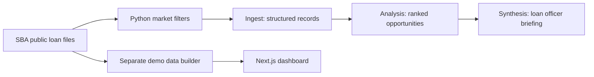

# Project Pipeline

A commercial lending research prototype for community banks. It turns SBA loan records into a market summary, a competitor watch list, and businesses worth researching for a possible refinancing conversation.

A community bank can use public loan activity to understand which lenders are winning business, which industries are borrowing, and where an existing loan may be approaching a useful review window. This helps a loan officer decide where to spend research time. A score is a lead for investigation, not evidence that a borrower wants or qualifies for refinancing.

**Portfolio edition:** every committed borrower, lender, address, and report example is fictional and labeled SYNTHETIC. Public Missouri county names describe the intended market. No original borrower records, credentials, or Git history are included.

## How it works

1. **Ingest:** Python downloads SBA 7(a) records and filters geography, loan size, and approval windows. A model structures the selected records into `contract1.json`.
2. **Analysis:** a second model scores and groups the records into `contract2.json`, including prospects, competitor activity, and industries.
3. **Synthesis:** a third model writes a short Markdown briefing for a loan officer.



The dashboard is a separate presentation of the same business idea. It reads JSON and can request an AI prospect brief; it does not run the three-stage Python pipeline. The standalone `sba_analysis.py` provides deterministic market summaries without model calls.

## Quick start: synthetic offline verification

Use Python **3.12** (verified with 3.12.7). These commands run from a fresh clone. Installing dependencies needs internet; the verification itself blocks network access and uses no API credentials.

```sh
git clone https://github.com/msanchez78158/project-pipeline.git
cd project-pipeline
python3.12 -m venv .venv
source .venv/bin/activate
python -m pip install -r requirements.txt
python -m unittest discover -s tests -v
```

The repository is private, so cloning requires an authorized GitHub account. Tests exercise the actual download/filter, payload, model-call, JSON parsing, and report-writing path with synthetic CSV responses and mocked model responses. Outputs are written to temporary directories. The test suite verifies orchestration and data handling; it does not evaluate a live model's accuracy or account availability.

Read [the synthetic briefing](examples/report_synthetic.md) for the human-readable result. The demo's independent synthetic dataset is committed, so the dashboard needs no SBA download.

## Run the dashboard

Requires Node **20.9+** (verified with Node 22).

```sh
cd demo
npm ci
cp .env.example .env.local
npm run dev
```

Open [localhost:3000](http://localhost:3000) to go directly to the dashboard. No access code or API key is required to browse. Leave `OPENROUTER_API_KEY` empty to explore without model calls. Expanding an AI brief requires a valid key and makes an external request. See [demo setup](demo/README.md).

This demo has no authentication, production authorization, or API rate limiting. Keep its dataset synthetic and run it locally.

## Optional: public SBA data analysis

Download the three relevant CSVs and the data dictionary from the official [SBA 7(a) & 504 FOIA page](https://data.sba.gov/dataset/7a-504-foia). The September 30, 2026 CSV links below returned HTTP 200 during preparation. SBA updates quarterly; use the landing page when releases change.

The standalone analysis currently expects historical local filenames. These commands deliberately save the newer downloads under those names; **the filename is not the snapshot date**. Record the actual release date when interpreting results.

```sh
# From the repository root, with the Python environment active:
curl --fail --location 'https://data.sba.gov/sites/default/files/uploaded_resources/FOIA_7a_FY2010_FY2019_asof_260930.csv' --output foia-7a-fy2010-fy2019-as-of-251231.csv
curl --fail --location 'https://data.sba.gov/sites/default/files/uploaded_resources/FOIA_7a_FY2020_Present_asof_260930.csv' --output foia-7a-fy2020-present-as-of-251231.csv
curl --fail --location 'https://data.sba.gov/sites/default/files/uploaded_resources/FOIA_504_FY2010_Present_asof_260930.csv' --output foia-504-fy2010-present-asof-251231.csv
python sba_analysis.py
```

Downloads total hundreds of megabytes and require additional memory when loaded. The script creates `market_recent_loans.csv` and `refi_window_prospects.csv`. Those files contain real public borrower records and are ignored by Git.

To use the separate dashboard data builder, place the two 7(a) CSVs in ignored `data/` with filenames matching `foia-7a-*.csv`, then run:

```sh
mkdir -p data
cp foia-7a-fy2010-fy2019-as-of-251231.csv data/
cp foia-7a-fy2020-present-as-of-251231.csv data/
python scripts/build_demo_data.py
```

This **overwrites** `demo/data/prospects.json` with real public records. Use a separate local working copy for that experiment; never commit or publish the resulting JSON. FRED is optional; `PRIME_RATE_OVERRIDE` takes precedence, otherwise a historical fallback is used when FRED is unavailable.

## Optional: live model pipeline

```sh
cp .env.example .env
# Set OPENROUTER and select available PIPELINE_*_MODEL identifiers in .env.
python pipeline.py 2026-Q4
```

Before live use, refresh the legacy `SBA_URLS`, snapshot metadata, and historical rate benchmarks in `pipeline.py` against the current official release. The live path retains these prototype assumptions; the documented offline tests replace downloads at the HTTP boundary. No paid live model execution was performed for this portfolio edition. Live runs send selected public loan records to OpenRouter and its model providers and write ignored `pipeline_runs/<label>/` outputs.

`build_contract1.py` runs only the Python data layer, writes under a hardcoded `2026-Q1` label, and still requires `OPENROUTER` because of its import. It is retained for inspection as an earlier workflow utility; the offline test command above is the reproducible entry point.

## Synthetic sample output

> **SYNTHETIC — fictional data, not a lending recommendation.**
>
> SYNTHETIC COMMUNITY BANK has one refinancing research candidate: SYNTHETIC CEDAR TOOLWORKS LLC, with a fictional $750,000 loan approved 26 months ago. Its 11.50% illustrative origination rate exceeds the prototype's 9.50% benchmark by 2.00 percentage points. A simple interest-only comparison is $15,000 per year before balances, fees, and loan terms. Confirm every assumption before considering outreach.

See the full [synthetic report](examples/report_synthetic.md) and [synthetic input records](examples/synthetic_loans.csv). These are hand-authored fixtures, not masked versions of real records.

## Project structure

```text
pipeline.py                 Three-stage model workflow
sba_analysis.py             Independent local CSV analysis
build_contract1.py          Data-only intermediate-contract utility
requirements.txt            Python dependencies used for verification
.env.example                Python/generator configuration placeholders
examples/                   Wholly synthetic records and report
tests/                     Offline tests (no external services)
scripts/build_demo_data.py  Separate SBA-to-dashboard data builder
demo/                       Next.js UI, API route, synthetic JSON
LICENSE                     Apache-2.0
```

## Technology

Python, pandas, requests, python-dateutil, python-dotenv, tabulate, and the OpenAI-compatible client for OpenRouter; Next.js, React, TypeScript, and Tailwind CSS for the dashboard. Model IDs are configurable inherited defaults, not a promise of current availability or price.

## Honest limitations

- SBA approvals are historical records, not current balances, current rates, borrower intent, or credit decisions. Contacts require independent research; no contact list is included.
- The output label does not control filtering dates. The code uses today's date and has a six-month new-loan window while its prompt says 90 days.
- Root filtering excludes literal St. Louis City despite broader prompt claims. Root and demo geographies and minimum loan sizes differ.
- Scoring is a heuristic. Model rankings, calculations, and prose are not independently validated. JSON repair can also conceal incomplete model responses.
- Rate benchmarks and snapshot metadata are historical. Variable origination rates and approval-plus-term maturity estimates can mislead. Dashboard savings use a simplified original-principal calculation.
- The demo's JSON and paid API endpoint have no authentication. Production deployment would require authentication, authorization, usage controls, and a reviewed data-sharing policy.
- The offline tests verify synthetic paths, not every SBA schema variation, live endpoint, model, or production behavior.

## What's next

Future work would align date windows and geography, refresh data/rate configuration, validate model totals against deterministic calculations, and evaluate report quality with a reviewed dataset. Production access controls would come before any real-data deployment. These are proposed improvements, not implemented features.

## License

Apache License 2.0, matching ReqVue. The source dataset is distributed separately by SBA; consult the official download page for its terms.
